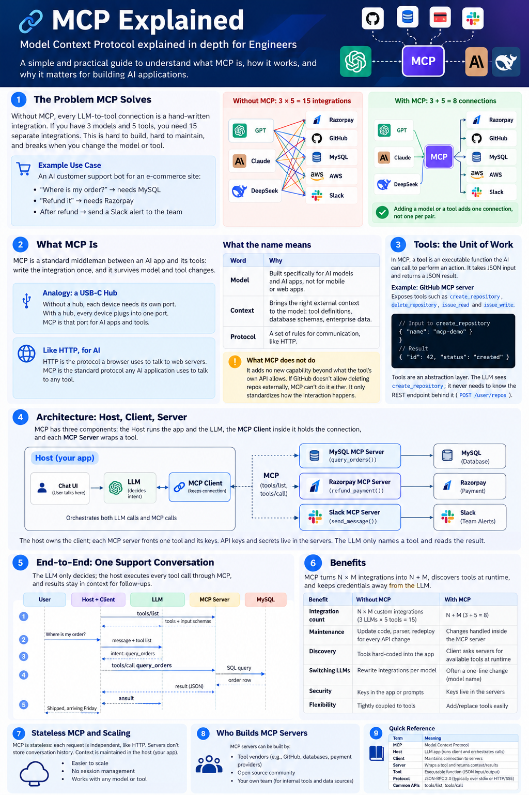
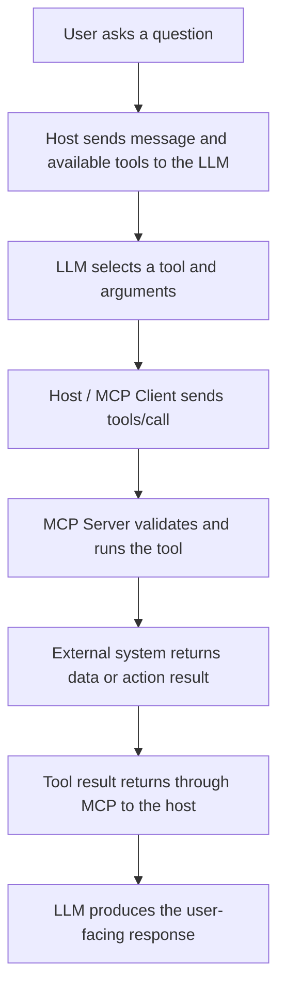
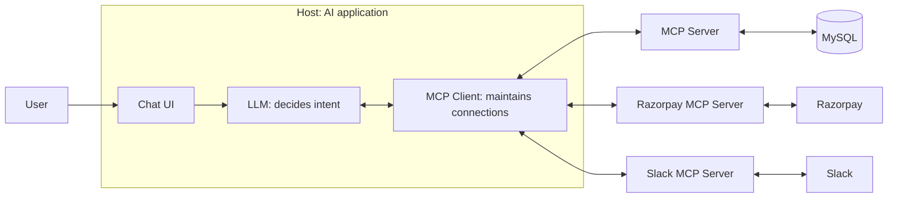
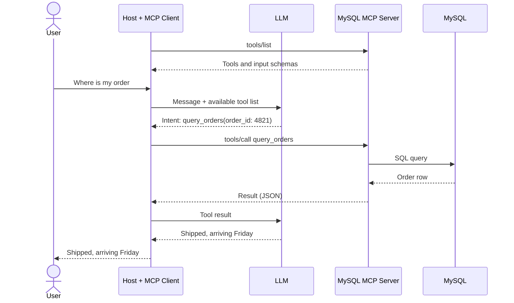

# MCP Explained

**Model Context Protocol (MCP) explained in depth for engineers**

This README converts the source notes into a GitHub-friendly Markdown document. It follows the original nine-section structure and preserves the examples and caveats from the notes.



> **Visual overview:** This infographic summarizes the MCP problem, the Host–Client–Server architecture, a sample tool-call workflow, and the main benefits. Some labels in the image are simplified for visual learning; use the detailed sections below for the precise explanations and caveats.


## Visual guide: how an MCP tool call works

The infographic above gives the big picture. This smaller diagram focuses on one request from the user to an external service and back.



**Remember:** the LLM chooses a tool; the host and MCP client coordinate the call; the MCP server handles the connection to the underlying service.

---

## Table of Contents

1. [The Problem MCP Solves](#1-the-problem-mcp-solves)
2. [What MCP Is](#2-what-mcp-is)
3. [Tools: The Unit of Work](#3-tools-the-unit-of-work)
4. [Architecture: Host, Client, Server](#4-architecture-host-client-server)
5. [End-to-End: One Support Conversation](#5-end-to-end-one-support-conversation)
6. [Benefits](#6-benefits)
7. [Stateless MCP and Scaling](#7-stateless-mcp-and-scaling)
8. [Who Builds MCP Servers](#8-who-builds-mcp-servers)
9. [Quick Reference](#9-quick-reference)

---

## 1. The Problem MCP Solves

Without MCP, every connection between a large language model (LLM) and a tool requires a hand-written integration. For example, connecting **3 models** to **5 tools** can require **15 integrations**.

### Running example: an e-commerce customer support bot

- **“Where is my order?”** requires access to MySQL.
- **“Refund it”** requires Razorpay and a Slack alert to the team.

For each tool, a custom integration typically requires developers to:

1. Call the tool's specific API endpoint.
2. Parse its response using a custom parser.
3. Update the code and parser, then redeploy, whenever the API changes.

This is the classic **N × M problem**:

\[
\text{Number of integrations} = N \times M
\]

Here, `N` is the number of models and `M` is the number of tools. This approach is difficult to build and maintain. It can also break when changing the model (for example, GPT to DeepSeek) or the tool (for example, MySQL to PostgreSQL).

### Integration count example

| Approach | Calculation | Number of connections |
|---|---:|---:|
| Without MCP | 3 models × 5 tools | 15 |
| With MCP | 3 models + 5 tools | 8 |

With MCP, adding a model or a tool adds one connection rather than requiring a new integration for every model-tool pair.

## 2. What MCP Is

**MCP is a standard middleman between an AI application and its tools.** The integration is written against a common protocol, helping it survive changes to the model or tool.

### Analogy: a USB-C hub

Without a hub, each device may need its own port or custom connection logic. With a hub, devices connect through a common interface. MCP plays a similar role between an AI application and external tools.

### Like HTTP, but for AI tool connections

HTTP is a protocol browsers use to communicate with web servers. MCP is a standard protocol AI applications can use to communicate with tools and provide context to models.

MCP is designed around AI applications: tools can be discovered and selected at runtime rather than every tool call needing to be hard-coded into the application.

### What does MCP stand for?

| Word | Meaning in the notes |
|---|---|
| **Model** | Built specifically for AI models and AI applications, rather than mobile or web applications. |
| **Context** | Brings relevant external context to the model, such as tool definitions, database schemas, and enterprise data. |
| **Protocol** | A set of communication rules, similar in concept to HTTP. |

> **What MCP does not do:** MCP does not add capabilities that the underlying tool's API does not allow. If GitHub does not permit an operation through its API, MCP cannot make that operation possible. MCP standardizes how the interaction happens.

## 3. Tools: The Unit of Work

In MCP, a **tool** is an executable function an AI application can call to perform an action. It takes JSON input and returns a result, commonly represented as JSON.

For example, a GitHub MCP server might expose tools such as:

- `create_repository`
- `delete_repository`
- `issue_read`
- `issue_write`

### Example tool input and result

Input to `create_repository`:

```json
{
  "name": "mcp-demo"
}
```

Example result:

```json
{
  "id": 42,
  "status": "created"
}
```

Tools provide an abstraction layer. The LLM can request `create_repository` without needing to know the underlying REST endpoint, such as `POST /user/repos`. Changes to the endpoint can be handled inside the MCP server rather than requiring changes to the application or prompts.

## 4. Architecture: Host, Client, Server

MCP architecture has three main components:

| Component | What it is | Example |
|---|---|---|
| **Host** | The LLM-powered application users interact with. It owns the client and orchestrates LLM calls and MCP calls. It can be implemented using different languages or frameworks. | A chatbot backend, Codex, or Claude Code |
| **MCP Client** | Lives inside the host. Maintains a connection to an MCP server, sends requests, and receives context or results for the host to use. | The support bot's MCP connector |
| **MCP Server** | A program that exposes tools or context by wrapping an underlying tool or API. It executes commands or fetches data and returns results in a format the AI application can use. | A MySQL MCP server or GitHub MCP server |

### Architecture diagram

The host contains the chat interface, LLM, and MCP client. The client connects to the relevant MCP servers; each server fronts its external service.



Examples of tools behind the servers:

| MCP server | Example tool | External system |
|---|---|---|
| MySQL MCP server | `query_orders()` | MySQL |
| Razorpay MCP server | `refund_payment()` | Razorpay |
| Slack MCP server | `send_message()` | Slack |

**Credentials and secrets:** The notes describe API keys and secrets as residing in the MCP servers. The LLM names a tool and reads its result; it does not need to receive the tool's secret credentials.

The host owns the client. The client reaches the relevant MCP server, and each server handles access to its underlying tool or service.

## 5. End-to-End: One Support Conversation

The LLM decides which tool to request, but the host executes the call through MCP. Tool results can then be used as context for follow-up questions.

### Step-by-step workflow

1. **Tool discovery:** At startup, the client asks each MCP server which tools it exposes using `tools/list`. Each server returns its available tools and an input schema for each tool. The host makes this information available to the LLM.
2. **User query:** The user asks, “Where is my order #4821?” The host sends the message to the LLM along with the available tool information.
3. **LLM decides:** The LLM indicates that `query_orders` should be called with `order_id: 4821`. It does not execute the database query itself.
4. **Host executes:** The host sends the tool request through the MCP client to the MCP server. The server queries MySQL and returns the result.
5. **LLM responds:** The host forwards the result to the LLM, which produces a user-facing answer, such as “Shipped, arriving Friday.”
6. **Conversation continues:** If the user then asks for a refund, the order and product details may already be in context, allowing the LLM to request Razorpay's `refund_payment` tool without querying the database again, as described in the source notes.

### Sequence diagram



The key distinction is that **the LLM selects the tool, while the host and MCP client carry out the tool call**. The LLM does not directly connect to the MCP server or database.

## 6. Benefits

The notes identify these benefits of MCP:

| Benefit | Without MCP | With MCP |
|---|---|---|
| **Integration count** | `N × M` custom integrations; for 3 models and 5 tools, this is 15. | `N + M` connections; for the same example, this is 8. |
| **Maintenance** | API changes may require code and parser changes, followed by redeployment. | Changes can be handled inside the MCP server. |
| **Discovery** | Tools are hard-coded into the application. | The client asks servers for available tools and capabilities; the LLM can choose at runtime. |
| **Switching LLMs** | Integrations may need to be rewritten for each model. | Switching can often be as simple as changing the model configuration, depending on the application. |
| **Security** | Direct integrations can lead to credentials being exposed to the LLM if handled poorly. | Keys, tokens, and secrets can remain in the MCP server; the LLM invokes tools without needing to see them. |

MCP standardizes the interaction layer. It does not eliminate the need to implement, secure, monitor, or maintain the underlying integrations.

## 7. Stateless MCP and Scaling

The notes describe a shift toward stateless MCP interactions, while explicitly advising readers to verify the current MCP specification before relying on stateless behavior in production.

- **Stateful:** Requests belong to a session that the server remembers. A client may need to keep sending requests to the same server instance, known as session pinning.
- **Stateless:** Each request carries what it needs, so any suitable server instance can handle it.
- **Why it matters:** Stateless request handling can make horizontal scaling simpler. Additional server instances can be placed behind a load balancer, potentially using round-robin distribution without session pinning.

> **Caveat from the notes:** Confirm behavior against the current MCP specification version before relying on stateless behavior in production.

## 8. Who Builds MCP Servers?

The notes describe three broad sources of MCP servers:

| Type | Built by | Strengths | Watch out for |
|---|---|---|---|
| **Enterprise / official** | The tool vendor, such as GitHub for its own MCP server | The vendor knows its API and can keep the server current. | An official server may not exist for every tool. |
| **Open source** | The community; the notes give Anthropic's reference servers for file systems, databases, and web as examples. | A useful starting point when no official server exists. | Capabilities may be limited for production, and updates must be tracked. |
| **Custom** | Your own team | Supports custom business logic and enterprise requirements, with greater control over implementation. | Your team owns building, securing, and maintaining it. |

### One server per tool, or one server for many?

Both approaches are possible:

- A separate MCP server can front each tool.
- An aggregator can expose many tools through one MCP server. The notes name Zapier, Pipedream, and Make as examples.
- A team can build its own aggregator for internal tools when existing options do not cover the required APIs.

Choose the arrangement based on the required integrations, control, security, and maintenance responsibilities.

## 9. Quick Reference

| Term | Meaning |
|---|---|
| **Tool** | An executable function exposed through an MCP server; JSON input and a result are exchanged. |
| `tools/list` | Discovery request that asks a server which tools it provides and returns their input schemas. |
| `tools/call` | Request used to invoke a tool with arguments. |
| **Intent** | The LLM's decision about which tool to call and with which arguments; the host executes the call. |
| **Host** | The LLM application; owns the client and orchestrates LLM and MCP calls. |
| **MCP Client** | The connection component inside the host that communicates with MCP servers. |
| **MCP Server** | Wraps a tool or API, serves context, and handles access to the underlying system. |
| **Aggregator** | An MCP server that exposes many tools, such as an integration platform or a custom internal aggregator. |

### Additional protocol details in the notes

The source notes also state that:

- MCP messages use **JSON-RPC 2.0**.
- Common transports include **stdio** for local communication and **Streamable HTTP** for remote communication.
- MCP servers can expose **resources** and **prompts** in addition to tools.

---

*Keep learning and keep exploring!*
