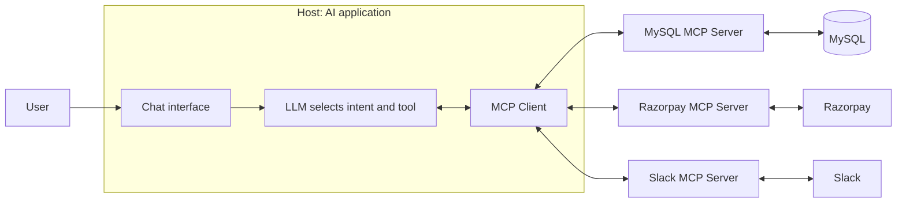
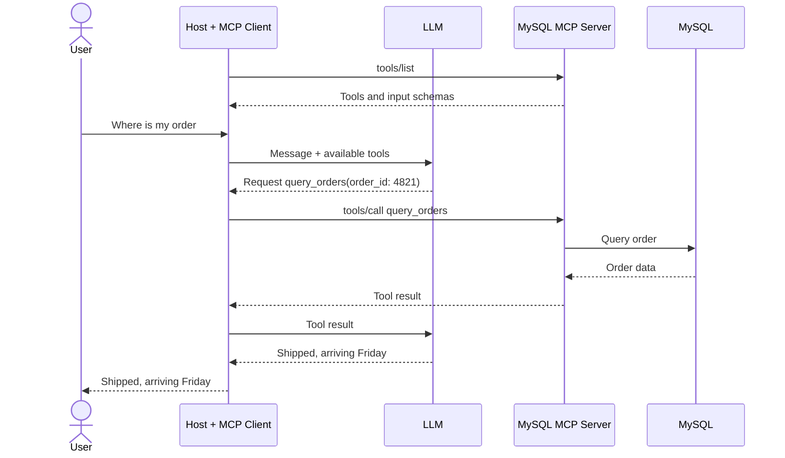

# Model Context Protocol (MCP)

Model Context Protocol (MCP) is a standard protocol that connects AI applications with external tools and context. It provides a common way for an AI application to discover tools and request their execution without requiring a separate, model-specific integration for every tool.

## Table of Contents

1. [The Problem MCP Solves](#1-the-problem-mcp-solves)
2. [What MCP Is](#2-what-mcp-is)
3. [Tools: The Unit of Work](#3-tools-the-unit-of-work)
4. [Architecture: Host, Client, and Server](#4-architecture-host-client-and-server)
5. [End-to-End Workflow](#5-end-to-end-workflow)
6. [Benefits](#6-benefits)
7. [Stateless MCP and Scaling](#7-stateless-mcp-and-scaling)
8. [Who Builds MCP Servers](#8-who-builds-mcp-servers)
9. [Quick Reference](#9-quick-reference)

---

## 1. The Problem MCP Solves

Without MCP, each connection between a large language model (LLM) and a tool may require a custom integration. For example, connecting 3 models to 5 tools can require 15 integrations.

Consider an e-commerce customer-support bot:

- “Where is my order?” requires access to MySQL.
- “Refund it” requires Razorpay and a Slack alert to the team.

For each tool, a custom integration may require developers to:

1. Call the tool's specific API endpoint.
2. Parse its response using a custom parser.
3. Update the code and parser, then redeploy, whenever the API changes.

This is the **N × M problem**:

\[
\text{Integrations} = N \times M
\]

Here, `N` is the number of models and `M` is the number of tools. This can make integrations difficult to maintain and can complicate changing models or tools.

### Example integration count

| Approach | Calculation | Connections |
|---|---:|---:|
| Without MCP | 3 models × 5 tools | 15 |
| With MCP | 3 models + 5 tools | 8 |

With MCP, adding a model or tool adds one connection rather than requiring a new integration for every model-tool pair.

## 2. What MCP Is

MCP is a standard middle layer between an AI application and its tools. The application integrates with the protocol, while MCP servers expose tools or context from external systems.

### Analogy: a USB-C hub

Without a hub, devices may need different ports or custom connection logic. With a hub, devices connect through a common interface. MCP serves a similar purpose for AI applications and tools.

### What the name means

| Word | Meaning |
|---|---|
| **Model** | Designed for AI models and AI applications. |
| **Context** | Supplies relevant external context, such as tool definitions, database schemas, and enterprise data. |
| **Protocol** | A set of communication rules. |

> **Limitation:** MCP does not add capabilities that the underlying tool or API does not allow. It standardizes how the AI application interacts with that tool.

## 3. Tools: The Unit of Work

An MCP **tool** is an executable function that an AI application can request. It accepts input arguments and returns a result, commonly represented as JSON.

A GitHub MCP server might expose tools such as:

- `create_repository`
- `delete_repository`
- `issue_read`
- `issue_write`

### Example tool input

```json
{
  "name": "mcp-demo"
}
```

### Example result

```json
{
  "id": 42,
  "status": "created"
}
```

Tools abstract the underlying implementation. For example, an LLM can request `create_repository` without needing to know the underlying REST endpoint, such as `POST /user/repos`. The MCP server handles the integration with the underlying API.

## 4. Architecture: Host, Client, and Server

MCP has three main components.

| Component | Responsibility | Example |
|---|---|---|
| **Host** | The AI application the user interacts with. It contains or coordinates the LLM and orchestrates model and MCP calls. | A customer-support chatbot |
| **MCP Client** | Lives inside the host and maintains communication with MCP servers. It sends requests and receives results or context. | The chatbot's MCP connector |
| **MCP Server** | Exposes tools or context and connects to the underlying service or data source. | A MySQL or GitHub MCP server |

### Architecture diagram



Example tools in this architecture:

| MCP server | Example tool | External system |
|---|---|---|
| MySQL MCP server | `query_orders()` | MySQL |
| Razorpay MCP server | `refund_payment()` | Razorpay |
| Slack MCP server | `send_message()` | Slack |

Credentials and secrets should be handled securely by the server or integration layer. The model can request a tool and interpret its result without needing to be given the service's secret credentials.

## 5. End-to-End Workflow

The LLM chooses which tool to request. The host and MCP client coordinate the call, and the MCP server interacts with the underlying service.

1. **Tool discovery:** The client requests `tools/list` from an MCP server. The server returns the available tools and their input schemas.
2. **User query:** The user asks, “Where is my order #4821?” The host sends the message and available tool information to the LLM.
3. **Tool selection:** The LLM requests `query_orders` with `order_id: 4821`. It does not execute the database query itself.
4. **Tool execution:** The host sends the request through the MCP client to the MCP server. The server queries MySQL.
5. **Result returned:** The tool result returns to the host and is provided to the LLM.
6. **User-facing response:** The LLM generates an answer, such as “Shipped, arriving Friday.”
7. **Follow-up:** If the user asks for a refund, the application may use order details already present in context to request Razorpay's `refund_payment` tool.

### Workflow diagram



**Key distinction:** The LLM selects a tool; the host and client coordinate the call; the MCP server handles the connection to the underlying system.

## 6. Benefits

| Benefit | Without MCP | With MCP |
|---|---|---|
| **Integration count** | `N × M` custom integrations | The example in these notes reduces 15 connections to 8 (`N + M`). |
| **Maintenance** | API changes can require updates to code and parsers. | Integration changes can often be handled within the MCP server. |
| **Discovery** | Tools may be hard-coded into the application. | The client can discover tools and their input schemas at runtime. |
| **Switching models** | Integrations may be tied to a particular model. | A common protocol can reduce model-specific integration work. |
| **Credential handling** | Direct integrations can expose secrets if implemented poorly. | Secrets can remain in the server/integration layer rather than being supplied to the LLM. |

MCP standardizes communication, but it does not eliminate the need to implement, secure, monitor, or maintain integrations.

## 7. Stateless MCP and Scaling

The source notes describe stateless request handling as useful for scaling, but they also advise checking the current MCP specification before relying on specific behavior in production.

- **Stateful:** The server remembers session state. A client may need to continue communicating with the same server instance, known as session pinning.
- **Stateless:** Each request contains what is needed for that request, allowing any suitable server instance to handle it.
- **Scaling:** Stateless request handling can simplify horizontal scaling behind a load balancer and may avoid session pinning.

> **Caveat:** Verify the behavior against the current MCP specification and the specific server implementation before relying on stateless behavior in production.

## 8. Who Builds MCP Servers?

| Type | Built by | Strengths | Considerations |
|---|---|---|---|
| **Official / enterprise** | The tool vendor | The vendor understands its API and can maintain the integration. | An official server may not exist for every tool. |
| **Open source** | Community contributors | Can be a starting point when no official server exists. | Capabilities and maintenance vary; updates must be tracked. |
| **Custom** | Your team | Can implement custom business logic and internal integrations. | Your team owns development, security, and maintenance. |

A server can expose one tool or many tools. An **aggregator** exposes tools from multiple systems through one MCP server. The source notes mention platforms such as Zapier, Pipedream, and Make as examples, as well as custom aggregators for internal tools.

## 9. Quick Reference

| Term | Meaning |
|---|---|
| **Tool** | An executable function exposed through an MCP server. |
| `tools/list` | Requests the list of available tools and their input schemas. |
| `tools/call` | Invokes a tool with arguments. |
| **Intent** | The LLM's decision about which tool to request and which arguments to use. |
| **Host** | The AI application that coordinates LLM and MCP interactions. |
| **MCP Client** | The component inside the host that communicates with MCP servers. |
| **MCP Server** | Exposes tools or context and connects to underlying services. |
| **Aggregator** | An MCP server that exposes tools from multiple systems. |
| **JSON-RPC 2.0** | The message format identified in the source notes. |
| **stdio** | A transport used for local communication. |
| **Streamable HTTP** | A transport used for remote communication. |
| **Resources and prompts** | Additional types of content MCP servers can expose alongside tools, as noted in the source material. |
