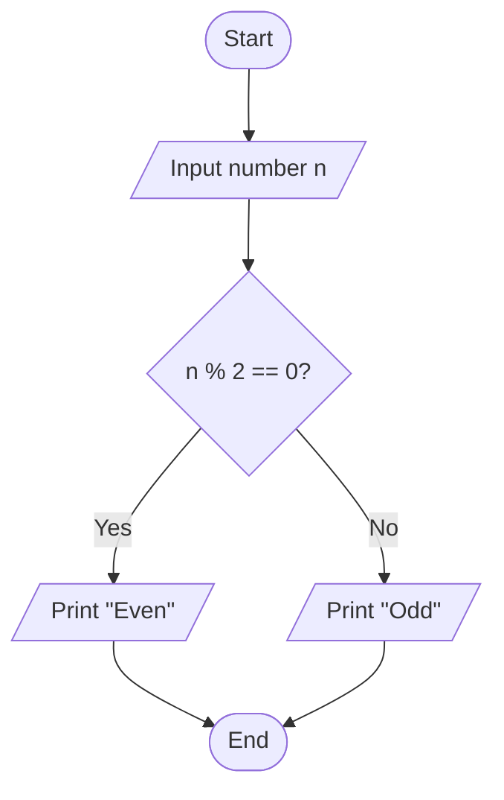

# Programming Fundamentals and Problem-Solving Concepts

This README covers 42 core programming concepts across programming fundamentals, problem-solving, and object-oriented programming (OOP). The examples primarily use Python, while noting where Java behaves differently. These concepts provide a foundation for learning programming, Data Structures and Algorithms (DSA), software testing, and AI development.

## Table of Contents

- **[Part 1: Programming Fundamentals](#part-1-programming-fundamentals)**
  - **1.** [Variables](#1-variables)
  - **2.** [Constants](#2-constants)
  - **3.** [Data Types](#3-data-types)
  - **4.** [Type Conversion](#4-type-conversion)
  - **5.** [Operators](#5-operators)
  - **6.** [Expressions](#6-expressions)
  - **7.** [Statements](#7-statements)
  - **8.** [Input/Output](#8-inputoutput)
  - **9.** [Conditional Statements](#9-conditional-statements)
  - **10.** [Loops](#10-loops)
  - **11.** [Nested Loops](#11-nested-loops)
  - **12.** [Functions](#12-functions)
  - **13.** [Parameters and Arguments](#13-parameters-and-arguments)
  - **14.** [Return Values](#14-return-values)
  - **15.** [Scope](#15-scope)
  - **16.** [Lifetime of Variables](#16-lifetime-of-variables)
  - **17.** [Mutability and Immutability](#17-mutability-and-immutability)
  - **18.** [References](#18-references)
  - **19.** [Value vs. Reference Semantics](#19-value-vs-reference-semantics)
  - **20.** [Recursion](#20-recursion)

- **[Part 2: Problem-Solving Concepts](#part-2-problem-solving-concepts)**
  - **21.** [Problem Decomposition](#21-problem-decomposition)
  - **22.** [Requirement Analysis](#22-requirement-analysis)
  - **23.** [Input/Output Analysis](#23-inputoutput-analysis)
  - **24.** [Edge Cases](#24-edge-cases)
  - **25.** [Constraints](#25-constraints)
  - **26.** [Pseudocode](#26-pseudocode)
  - **27.** [Flowcharts](#27-flowcharts)
  - **28.** [Logical Thinking](#28-logical-thinking)
  - **29.** [Pattern Recognition](#29-pattern-recognition)
  - **30.** [Abstraction](#30-abstraction)
  - **31.** [Step-by-Step Problem Solving](#31-step-by-step-problem-solving)
  - **32.** [Trade-off Analysis](#32-trade-off-analysis)
---

# Part 1: Programming Fundamentals

## 1. Variables

**Meaning:** A variable is a name that refers to a value or object used by a program.

```python
name = "Kunal"
age = 25
salary = 45000.50

print(name)
print(age)
print(salary)
```

**Practical use:** Storing a customer's name, a stock price, a patient's age, or a user's login status.

**Key points:**
- Variables can be reassigned.
- Python determines a variable's type dynamically.
- Use meaningful names such as `total_price` instead of vague names such as `x`.

```python
age = 25
age = 26
print(age)  # 26
```

## 2. Constants

**Meaning:** A constant represents a value that should not change during normal program execution.

Python does not enforce constants, but uppercase names communicate the convention.

```python
PI = 3.14159
MAX_LOGIN_ATTEMPTS = 3

radius = 5
area = PI * radius ** 2
print(area)
```

In Java, use `final` to prevent reassignment:

```java
final double PI = 3.14159;
```

**Practical use:** Fixed configuration values, maximum limits, tax rates, and mathematical constants.

**Important:** Python's `PI` can still be reassigned. Java's `final` prevents reassignment of that variable.

## 3. Data Types

**Meaning:** A data type describes the kind of value a program works with and the operations that value supports.

| Type | Example | Purpose |
|---|---|---|
| `int` | `25` | Whole numbers |
| `float` | `99.50` | Floating-point numbers |
| `str` | `"Hello"` | Text |
| `bool` | `True` | Logical values |
| `list` | `[10, 20, 30]` | Ordered, mutable collection |
| `tuple` | `(10, 20)` | Ordered, immutable collection |
| `dict` | `{"name": "Kunal"}` | Key-value mapping |
| `set` | `{10, 20, 30}` | Collection of unique elements |
| `NoneType` | `None` | Absence of a value |

```python
age = 25
name = "Kunal"
is_active = True

print(type(age))
print(type(name))
print(type(is_active))
```

**Practical use:** Representing money, text, dates, user records, and collections of data.

## 4. Type Conversion

**Meaning:** Type conversion changes a value from one data type to another.

```python
age = "25"
age_number = int(age)

print(age_number + 5)  # 30
```

Common Python conversion functions include `int()`, `float()`, `str()`, and `bool()`.

- **Explicit conversion:** You request the conversion, such as `int("25")`.
- **Implicit conversion:** The language performs certain conversions automatically, according to its rules.

```python
price = "100.50"
price_number = float(price)
print(price_number * 2)  # 201.0
```

**Watch out:** `int("hello")` raises a `ValueError`.

**Practical use:** Converting form inputs, API responses, CSV data, and user-entered numbers.

## 5. Operators

**Meaning:** Operators perform calculations, comparisons, assignments, and logical operations.

| Category | Examples | Purpose |
|---|---|---|
| Arithmetic | `+`, `-`, `*`, `/`, `//`, `%`, `**` | Mathematical calculations |
| Comparison | `==`, `!=`, `>`, `<`, `>=`, `<=` | Compare values |
| Logical | `and`, `or`, `not` | Combine conditions |
| Assignment | `=`, `+=`, `-=` | Assign or update values |
| Membership | `in`, `not in` | Check collection membership |
| Identity | `is`, `is not` | Check object identity |

```python
a = 10
b = 3

print(a + b)                 # 13
print(a // b)                # 3
print(a % b)                 # 1
print(a > b)                 # True
print(a > 5 and b < 5)       # True
```

**Important:** `==` compares values for equality. `is` checks whether two references identify the same object. Do not use `is` for ordinary string or number equality.

## 6. Expressions

**Meaning:** An expression is a combination of values, variables, operators, or function calls that produces a value.

```python
total = 10 + 20
discounted_price = 1000 * 0.90
is_adult = 25 >= 18
```

The expressions `10 + 20`, `1000 * 0.90`, and `25 >= 18` evaluate to `30`, `900.0`, and `True`.

**Practical use:** Calculating prices, validating conditions, computing averages, and evaluating business rules.

## 7. Statements

**Meaning:** A statement is an instruction that performs an action in a program.

```python
age = 25

print(age)

if age >= 18:
    print("Adult")
```

- An **expression** produces a value.
- A **statement** performs an instruction.

For example, `age + 5` is an expression, while `age = age + 5` is an assignment statement.

## 8. Input/Output

**Meaning:** Input receives information; output presents or sends information.

```python
name = input("Enter your name: ")
age = int(input("Enter your age: "))

print("Name:", name)
print("Age:", age)
```

In Python, `input()` returns a string, so convert numeric input when necessary.

**Practical use:** Command-line applications, registration forms, calculators, and programs that process user data.

## 9. Conditional Statements

**Meaning:** Conditional statements let a program choose which instructions to execute based on a condition.

```python
marks = 75

if marks >= 90:
    print("Grade A")
elif marks >= 60:
    print("Grade B")
else:
    print("Grade C")
```

The program checks conditions in order. Once a matching branch is found, its block executes.

**Practical use:** Login validation, order eligibility, stock alerts, grading systems, and financial calculations.

## 10. Loops

**Meaning:** A loop repeats instructions while iterating over a sequence or while a condition remains true.

### For loop

```python
for number in range(1, 6):
    print(number)
```

This prints the numbers 1 through 5.

### While loop

```python
count = 1

while count <= 5:
    print(count)
    count += 1
```

Use a `for` loop when iterating over a collection or known range. Use a `while` loop when repetition depends on a condition.

**Watch out:** An infinite loop can occur if its termination condition never becomes false.

## 11. Nested Loops

**Meaning:** A nested loop is a loop inside another loop.

```python
for row in range(1, 4):
    for col in range(1, 4):
        print("*", end=" ")
    print()
```

Output:

```text
* * *
* * *
* * *
```

The inner loop completes all its iterations for every iteration of the outer loop.

**Practical use:** Matrix operations, table generation, pattern printing, and comparing pairs of elements.

**Complexity note:** If two nested loops each execute `n` times, the work is often proportional to `n²`. Analyze the actual iteration counts rather than assuming all nested loops have the same complexity.

## 12. Functions

**Meaning:** A function is a reusable block of code that performs a specific task.

```python
def calculate_total(price, quantity):
    return price * quantity

result = calculate_total(100, 3)
print(result)  # 300
```

**Benefits:**
- Reduces duplicated code.
- Makes programs easier to test.
- Breaks complex problems into smaller tasks.
- Improves readability and maintenance.

**Practical use:** Reusing calculations, validating input, processing API data, and building application components.

## 13. Parameters and Arguments

These terms are related but different:

- **Parameter:** A variable declared in a function definition.
- **Argument:** The actual value or object supplied when calling the function.

```python
def greet(name):       # name is a parameter
    print("Hello", name)

greet("Kunal")         # "Kunal" is an argument
```

Python supports positional arguments, keyword arguments, default parameter values, and variable-length arguments.

## 14. Return Values

**Meaning:** A return value is the result a function sends back to the code that called it.

```python
def square(number):
    return number * number

result = square(5)
print(result)  # 25
```

Compare `return` with `print`:

```python
def add(a, b):
    return a + b

def display_sum(a, b):
    print(a + b)
```

`add()` returns a value that can be stored, reused, or passed to another function. `display_sum()` prints the result but does not explicitly return it, so it returns `None`.

## 15. Scope

**Meaning:** Scope determines where a variable name can be accessed.

```python
name = "Global"

def show_name():
    message = "Local"
    print(name)
    print(message)

show_name()
print(name)
```

Here, `name` is global, while `message` is local to `show_name()`. Trying to access `message` outside the function raises a `NameError`.

Python follows the LEGB name-resolution rule: **Local, Enclosing, Global, Built-in**.

**Practical use:** Preventing naming conflicts and controlling which parts of a program can access a variable.

## 16. Lifetime of Variables

**Meaning:** Lifetime refers to how long a variable binding or the object it references remains available during program execution.

```python
def calculate():
    result = 100
    return result

print(calculate())
```

The local name `result` belongs to the function's local scope. After the function returns, that local binding is no longer available to ordinary code outside the function. The returned value can survive because another part of the program holds a reference to it.

**Important distinction:** Scope describes where a name is accessible; lifetime describes how long a binding or object exists. In Python, an object can outlive the function that created it if references to it remain.

## 17. Mutability and Immutability

**Meaning:** Mutability describes whether an object can be changed after creation.

### Mutable objects

Lists, dictionaries, and sets can be modified in place.

```python
numbers = [1, 2, 3]
numbers.append(4)
print(numbers)  # [1, 2, 3, 4]
```

### Immutable objects

Integers, strings, and tuples cannot be modified in place.

```python
name = "Kunal"
name = name + " Joshi"
print(name)  # Kunal Joshi
```

The operation creates a new string value and rebinds `name`; it does not modify the original string.

**Practical use:** Understanding unexpected changes in lists, avoiding shared-state bugs, and writing predictable functions.

## 18. References

**Meaning:** In Python, a variable name refers to an object rather than containing an independent copy of that object.

```python
first = [10, 20, 30]
second = first

second.append(40)

print(first)   # [10, 20, 30, 40]
print(second)  # [10, 20, 30, 40]
```

Both names refer to the same list object.

To make a separate shallow copy:

```python
first = [10, 20, 30]
second = first.copy()

second.append(40)

print(first)   # [10, 20, 30]
print(second)  # [10, 20, 30, 40]
```

A shallow copy still shares nested objects. A deep copy may be needed when duplicating nested mutable data.

## 19. Value vs. Reference Semantics

**Meaning:** This topic describes what happens when values or objects are assigned or passed to functions.

Python uses object-reference passing, often described as **call-by-sharing**.

```python
def update_list(items):
    items.append(4)

numbers = [1, 2, 3]
update_list(numbers)

print(numbers)  # [1, 2, 3, 4]
```

The function mutates the shared list object.

However, reassigning the local parameter does not reassign the caller's variable:

```python
def replace_list(items):
    items = [100, 200]

numbers = [1, 2, 3]
replace_list(numbers)

print(numbers)  # [1, 2, 3]
```

Java also passes arguments by value. For object arguments, the copied value is a reference, so a method can mutate the referenced object but cannot reassign the caller's variable through that parameter.

**Practical use:** Debugging functions that modify lists, dictionaries, objects, and application state.

## 20. Recursion

**Meaning:** Recursion occurs when a function calls itself to solve a smaller version of the same problem.

A recursive solution needs:
1. A **base case** that stops recursion.
2. A **recursive case** that moves the problem toward the base case.

Example: factorial.

```python
def factorial(n):
    if n < 0:
        raise ValueError("n must be non-negative")

    if n <= 1:
        return 1

    return n * factorial(n - 1)

print(factorial(5))  # 120
```

Mathematically:

`5! = 5 × 4 × 3 × 2 × 1 = 120`

**Practical use:** Tree traversal, divide-and-conquer algorithms, and certain search problems.

Recursion is not always better than a loop. Deep recursion can exceed Python's recursion limit, so iterative solutions may be preferable.

---

# Part 2: Problem-Solving Concepts

## 21. Problem Decomposition

**Meaning:** Problem decomposition means breaking a large, complicated problem into smaller, manageable subproblems.

### Example: Build a banking application

Divide the application into modules:

- **Authentication:** Login and logout.
- **Accounts:** Balance and profile.
- **Transactions:** Transfer money.
- **Statements:** Transaction history.

Each module can be divided into smaller tasks and implemented separately.

**Practical use:** Building applications, designing software, writing test cases, and developing AI agents with separate responsibilities.

## 22. Requirement Analysis

**Meaning:** Requirement analysis means understanding exactly what a problem or application must do before implementation.

Consider the requirement: "Calculate a discount for eligible customers."

Questions to clarify:
- What makes a customer eligible?
- What is the discount percentage?
- Is there a maximum discount?
- What happens when the purchase amount is zero?
- Can the discount exceed the purchase amount?
- How should invalid inputs be handled?

Example requirement:
- Purchase amount must be greater than zero.
- Eligible customers receive a 10% discount.
- Other customers receive no discount.

```python
def calculate_discount(amount, eligible):
    if amount <= 0:
        raise ValueError("Amount must be positive")

    if eligible:
        return amount * 0.10

    return 0
```

**Practical use:** Turning business requirements into functional specifications, code, and test cases.

**Key lesson:** Unclear requirements can produce incorrect software even when the code is technically correct.

## 23. Input/Output Analysis

**Meaning:** Input/output analysis identifies what information a problem receives and what result it must produce.

Example: Calculate the average of three numbers.

| Element | Description |
|---|---|
| Input | Three numbers: `10`, `20`, `30` |
| Processing | Add the numbers and divide by 3 |
| Output | `20.0` |

```python
def average(a, b, c):
    return (a + b + c) / 3

print(average(10, 20, 30))  # 20.0
```

Before coding, ask:
1. What inputs are required?
2. What types should the inputs have?
3. What output is expected?
4. What rules transform the input into the output?
5. What should happen if input is missing or invalid?

**Practical use:** Coding challenges, API design, form validation, and automated testing.

## 24. Edge Cases

**Meaning:** Edge cases are unusual, boundary, or exceptional inputs that may reveal bugs in a solution.

Example: Divide two numbers.

```python
def divide(a, b):
    if b == 0:
        raise ValueError("Cannot divide by zero")

    return a / b
```

| Test input | Expected behavior |
|---|---|
| `divide(10, 2)` | Returns `5.0` |
| `divide(0, 5)` | Returns `0.0` |
| `divide(-10, 2)` | Returns `-5.0` |
| `divide(10, 0)` | Raises `ValueError` |
| `divide(1, 3)` | Returns approximately `0.3333...` |

Other common edge cases:
- Empty lists or strings.
- Duplicate values.
- Negative numbers.
- Very large numbers.
- Missing or null values.
- Inputs at the exact permitted limit.
- Invalid data types.

**Practical use:** Software testing, DSA interviews, financial calculations, and data processing.

An edge case is not automatically invalid. An empty list might be valid for one function and invalid for another; the requirements determine the expected behavior.

## 25. Constraints

**Meaning:** Constraints are restrictions or limits that a solution must satisfy.

Examples:
- `1 <= n <= 100000`: input size is between 1 and 100,000.
- Memory usage must stay within a limit.
- A response must arrive within a specified time.
- A withdrawal cannot exceed the available balance.
- A function must accept only positive integers.

Constraints affect which algorithm is appropriate.

For a sorted array containing one million elements:
- Linear search may inspect up to one million elements.
- Binary search can find a value in roughly 20 comparisons in the worst case.

Binary search has logarithmic time complexity:

`O(log n)`

For `n = 1,000,000`, `log2(n)` is approximately 20.

**Practical use:** Selecting algorithms, managing memory, meeting response-time requirements, and enforcing business rules.

## 26. Pseudocode

**Meaning:** Pseudocode is a language-independent way to describe an algorithm using simple, structured instructions.

Problem: Find the largest number in a non-empty list.

```text
START
    SET largest = first element

    FOR each number in the list
        IF number > largest
            SET largest = number

    RETURN largest
END
```

Python implementation:

```python
def find_largest(numbers):
    if not numbers:
        raise ValueError("List cannot be empty")

    largest = numbers[0]

    for number in numbers:
        if number > largest:
            largest = number

    return largest

print(find_largest([10, 45, 20, 8]))  # 45
```

**Practical use:** Planning algorithms before coding, communicating solutions, and preparing for coding interviews.

Pseudocode separates the logic of a solution from the syntax of a programming language.

## 27. Flowcharts

**Meaning:** A flowchart represents the steps and decisions of an algorithm visually.

### Common symbols

| Symbol | Meaning |
|---|---|
| Oval | Start or end |
| Rectangle | Process or operation |
| Diamond | Decision or condition |
| Parallelogram | Input or output |
| Arrow | Direction of flow |

### Example: Check whether a number is even



**Practical use:** Understanding workflows, explaining business logic, and planning complex processes before implementation.

## 28. Logical Thinking

**Meaning:** Logical thinking means reasoning through a problem using clear rules, conditions, and cause-and-effect relationships.

Example: A user can withdraw money only if:
- The account is active.
- The withdrawal amount is positive.
- The balance is sufficient.

```python
def can_withdraw(balance, amount, account_active):
    return (
        account_active
        and amount > 0
        and balance >= amount
    )

print(can_withdraw(5000, 1000, True))    # True
print(can_withdraw(500, 1000, True))     # False
print(can_withdraw(5000, 1000, False))   # False
```

Logical thinking involves:
- Identifying conditions.
- Understanding dependencies.
- Checking assumptions.
- Evaluating possible outcomes.
- Finding contradictions and missing cases.

**Practical use:** Business logic, debugging, test design, and building reliable applications.

## 29. Pattern Recognition

**Meaning:** Pattern recognition means identifying similarities, repetitions, or recurring structures across problems or data.

Example: Find the pattern in this sequence:

`2, 4, 6, 8, 10`

Each number increases by 2.

```python
for number in range(2, 11, 2):
    print(number)
```

A practical programming example is recognizing that these tasks share a similar structure:
- Finding the maximum value in a list.
- Finding the minimum value in a list.
- Counting values that satisfy a condition.

All three can involve iterating through a collection and maintaining a result.

**Practical use:** Recognizing DSA patterns, identifying repeated code, analyzing datasets, and detecting trends in machine learning.

**Caution:** A pattern that fits a few examples is not automatically a universal rule. Validate it against additional cases.

## 30. Abstraction

**Meaning:** Abstraction means focusing on essential behavior while hiding unnecessary implementation details.

```python
def calculate_tax(amount, tax_rate):
    return amount * tax_rate

tax = calculate_tax(1000, 0.18)
print(tax)  # 180.0
```

The caller needs to know that the function accepts an amount and a rate and returns the calculated tax. The caller does not need to repeat the calculation each time.

An everyday example is using an ATM. You select a withdrawal amount without needing to understand the internal banking network, database transactions, or cash dispenser mechanics.

**Practical use:** Functions, classes, APIs, software architecture, and AI model interfaces.

Abstraction is not simply hiding code. It means defining a clear interface and deciding which details users of that interface do not need to know.

## 31. Step-by-Step Problem Solving

**Meaning:** This is a systematic process for moving from a problem statement to a correct, tested solution.

Follow this workflow:

1. **Understand the problem:** Identify the required behavior and remove ambiguity.
2. **Identify inputs and outputs:** Define data types, expected results, and validation rules.
3. **Check constraints and edge cases:** List limits, boundary values, and invalid inputs.
4. **Design the algorithm:** Break the task down and write pseudocode.
5. **Implement the solution:** Translate the algorithm into working code.
6. **Test the solution:** Check normal, boundary, and exceptional cases.
7. **Analyze and improve:** Check correctness, time complexity, and memory use.

### Worked example: Find the largest number

Problem: Given a non-empty list of numbers, return the largest number.

1. Input: `[12, 45, 7, 89, 34]`
2. Expected output: `89`
3. Initialize `largest` to the first number.
4. Compare each number with `largest`.
5. Update `largest` whenever a bigger number appears.
6. Return the result.

```python
def find_largest(numbers):
    if not numbers:
        raise ValueError("Input list must not be empty")

    largest = numbers[0]

    for number in numbers:
        if number > largest:
            largest = number

    return largest
```

- **Time complexity:** `O(n)`, because the algorithm examines every element.
- **Auxiliary space complexity:** `O(1)`, because it uses a constant amount of additional storage.

## 32. Trade-off Analysis

**Meaning:** Trade-off analysis means comparing the advantages and disadvantages of different solutions before choosing one.

There is rarely a single best solution for every situation.

### Example: Searching for an element

| Approach | Advantages | Disadvantages |
|---|---|---|
| Linear search | Simple; works on unsorted data | May examine every element |
| Binary search | Efficient on sorted data | Requires sorted data and suitable access to elements |
| Hash-based lookup | Expected fast lookup | Uses extra memory; collisions and implementation details matter |

Other common trade-offs:
- **Speed vs. memory:** Caching can improve response time but requires storage.
- **Simplicity vs. flexibility:** A simple implementation may be easier to maintain but less adaptable.
- **Accuracy vs. latency:** A larger AI model may perform better on some tasks but respond more slowly and cost more.
- **Duplication vs. abstraction:** Reusing code reduces duplication, but excessive abstraction can make code harder to understand.

**Practical use:** Selecting algorithms, designing databases, optimizing applications, and choosing AI models.

The right solution depends on the requirements, constraints, expected workload, and cost of failure—not simply on which option sounds more advanced.

---


